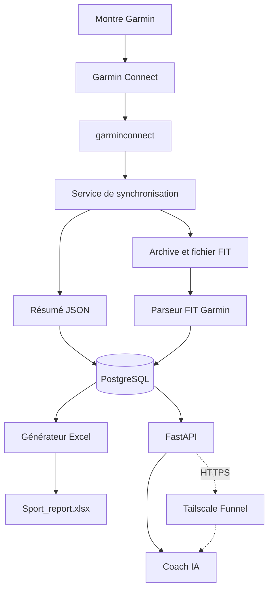

# Architecture du projet Sport

## 1. Objet du projet

Le projet Sport collecte automatiquement les activités enregistrées par une montre Garmin, conserve les données brutes et structurées sur une Raspberry Pi, puis les rend disponibles :

- à l'utilisateur dans un classeur Excel de synthèse ;
- à un coach IA via une API HTTP dédiée ;
- aux futurs outils d'analyse, sans dépendre de Strava.

Le projet est personnel et actuellement conçu pour un seul athlète. Il privilégie la conservation locale des données, la reproductibilité et un accès fin aux détails d'une activité.

## 2. État fonctionnel

Les fonctions suivantes sont opérationnelles :

- authentification à Garmin Connect avec persistance des jetons ;
- récupération des activités Garmin ;
- téléchargement des archives originales et des fichiers FIT ;
- extraction des résumés, tours et points enregistrés ;
- stockage dans PostgreSQL ;
- synchronisation idempotente des nouvelles activités ;
- reprise automatique après redémarrage de la Raspberry Pi ;
- API FastAPI pour le coach ;
- protection de l'API coach par jeton Bearer ;
- génération de rapports Excel annuels et globaux et d’un CSV des activités ;
- acces externe HTTPS permanent avec Tailscale Funnel.

Les éléments suivants restent à stabiliser :

- tunnel HTTPS permanent avec un nom de domaine stable ;
- sauvegarde PostgreSQL automatisée et test de restauration ;
- saisie du ressenti, du RPE et des commentaires ;
- gestion des objectifs et du plan d'entraînement ;
- tests automatisés du backend ;
- outil propre d'authentification Garmin initiale.

## 3. Vue générale



Strava peut continuer à recevoir les activités depuis Garmin Connect pour l'usage social, mais il n'intervient plus dans la collecte locale.

## 4. Flux d'une nouvelle activité

1. La montre synchronise une activité vers Garmin Connect.
2. La tâche planifiée exécute `app.services.garmin_sync`.
3. Le service charge les jetons Garmin existants.
4. Il récupère les activités récentes.
5. Il compare leur identifiant Garmin avec ceux présents dans PostgreSQL.
6. Pour chaque nouvelle activité, il récupère le résumé et les détails.
7. Il télécharge l'archive originale et extrait le fichier FIT.
8. Le parseur FIT extrait la session, les tours et les enregistrements.
9. L'ensemble est écrit dans PostgreSQL de façon idempotente.
10. L'API coach voit immédiatement les nouvelles données.
11. Si au moins une activité est nouvelle, la synchronisation régénère les fichiers des années concernées, le bilan global et le CSV.

Le classeur Excel n'est donc pas la source de vérité. PostgreSQL et les fichiers FIT originaux sont les sources principales.

## 5. Composants d'exécution

### 5.1 `sport-db`

- Image : PostgreSQL 17.
- Rôle : stockage relationnel des activités et métriques.
- Persistance : volume Docker nommé `sport_postgres_data`.
- Réseau : accessible uniquement depuis le réseau Docker.
- Le port PostgreSQL n'est pas publié sur la Raspberry Pi.

### 5.2 `sport-backend`

- Base : Python 3.13 slim.
- Serveur : Uvicorn et FastAPI.
- Accès aux données : SQLAlchemy et Psycopg.
- Migrations : Alembic.
- Garmin Connect : bibliothèque `garminconnect` non officielle.
- FIT : SDK FIT Garmin.
- Excel : `openpyxl`.
- Port actuel : `8000` publié uniquement sur `127.0.0.1` ; l'accès externe passe par Tailscale Funnel.

### 5.3 Tailscale Funnel

Tailscale Funnel publie actuellement le chemin suivant sans ouverture de port
sur la box :

```text
Internet -> Tailscale Funnel -> FastAPI -> PostgreSQL
```

L'URL publique actuelle est `https://rpi-home.tail3f4428.ts.net`. Funnel ne
publie que le service FastAPI local ; PostgreSQL reste prive sur le reseau
Docker. La configuration est persistante (`tailscale funnel --bg`) et survit
aux redemarrages.

## 6. Arborescence de référence

```text
/opt/sport/
├── .env                         # secrets locaux, jamais dans Git
├── .env.example                 # variables attendues, sans secret
├── .gitignore
├── compose.yaml
├── README.md
├── backend/
│   ├── Dockerfile
│   ├── requirements.txt
│   ├── alembic.ini
│   ├── alembic/
│   │   ├── env.py
│   │   ├── script.py.mako
│   │   └── versions/            # historique complet des migrations
│   └── app/
│       ├── main.py
│       ├── api/
│       │   └── coach.py
│       ├── core/
│       │   ├── config.py
│       │   └── security.py
│       ├── db/
│       │   ├── base.py
│       │   └── session.py
│       ├── models/
│       └── services/
│           ├── fit_parser.py
│           ├── garmin_sync.py
│           └── generate_excel.py
├── scripts/
│   └── sync-garmin.sh
├── docs/
│   ├── ARCHITECTURE.md
│   ├── INSTALLATION.md
│   └── COACH_IA.md
├── garmin-tokens/               # secret et persistant, ignoré par Git
├── data/
│   └── activities/              # FIT et archives, ignorés par Git
├── exports/                     # Sport_report.xlsx, ignoré par Git
└── backups/                     # sauvegardes, ignorées par Git
```

Les dossiers de données sont créés lors de l'installation et ne sont pas versionnés.

## 7. Responsabilités des modules

### `app/main.py`

- crée l'application FastAPI ;
- monte le routeur du coach ;
- expose `/health` et `/health/db`.

### `app/core/config.py`

- centralise la lecture de la configuration ;
- récupère notamment `DATABASE_URL` depuis l'environnement.

### `app/core/security.py`

- lit `COACH_API_KEY` ;
- contrôle l'en-tête `Authorization: Bearer ...` ;
- protège tous les endpoints sous `/api/coach`.

### `app/db/session.py`

- crée le moteur SQLAlchemy ;
- fournit `SessionLocal` aux services et endpoints.

### `app/db/base.py`

- déclare la base SQLAlchemy ;
- charge les modèles pour alimenter `Base.metadata` et Alembic.

### `app/services/garmin_sync.py`

- charge la session Garmin persistée ;
- détecte les activités absentes de la base ;
- télécharge et stocke leurs données ;
- appelle le parseur FIT ;
- constitue le point d'entrée de la synchronisation manuelle et planifiée.

### `app/services/fit_parser.py`

- décode les fichiers FIT ;
- extrait les informations de session ;
- construit les tours et points enregistrés ;
- ne doit pas supposer qu'une métrique Garmin est toujours présente.

### `app/services/generate_excel.py`

- lit PostgreSQL ;
- reconstruit entièrement le classeur Excel ;
- écrit les rapports dans `/var/lib/sport/exports/`, monté sur `/opt/sport/exports/` : `Sport_report_ANNEE.xlsx` par année, `Sport_report.xlsx` pour les comparaisons et records globaux, et `Sport_activities.csv` pour toutes les activités ;
- ne modifie pas la base de données.

### `app/api/coach.py`

- expose des résumés adaptés à un agent IA ;
- évite de retourner tous les points seconde par seconde par défaut ;
- permet une descente progressive du contexte général vers les données fines.

## 8. Modèle de données

### 8.1 `athletes`

Identifie l'athlète propriétaire des activités.

Champs principaux :

- identifiant interne ;
- identifiant Garmin ;
- prénom et nom ;
- date de création.

### 8.2 `activities`

Une ligne par activité Garmin.

Champs principaux :

- `garmin_activity_id`, identifiant externe unique ;
- nom et type de sport ;
- date de départ ;
- distance, durées et dénivelés ;
- fréquence cardiaque moyenne et maximale ;
- cadence ;
- puissance moyenne, normalisée et maximale ;
- Training Effects Garmin ;
- VO2max et calories ;
- résumé Garmin brut en JSON ;
- date de synchronisation.

Le générateur Excel filtre course à pied et trail pour les statistiques sportives principales. La marche et le vélo sont conservés en base et apparaissent dans le calendrier d'activité.

### 8.3 `activity_laps`

Une ligne par tour Garmin/FIT.

Champs principaux :

- activité parente ;
- index du tour ;
- distance et durée ;
- montée et descente ;
- fréquence cardiaque ;
- cadence et puissance ;
- vitesse ;
- dynamique de course lorsque disponible.

### 8.4 `activity_records`

Une ligne par point enregistré dans le FIT. Cette table représente le volume principal de la base.

Champs principaux :

- index et horodatage ;
- distance ;
- latitude et longitude ;
- altitude et vitesse ;
- fréquence cardiaque ;
- cadence et puissance ;
- métriques de dynamique de course.

Ces données ne sont pas exportées dans Excel. Elles sont demandées par le coach uniquement pour une analyse précise.

### 8.5 Modèles historiques

Des fichiers et migrations peuvent encore mentionner Strava ou `sync_events`. Avant de retirer un modèle Python historique, vérifier ses imports dans `app/models/__init__.py`, `app/db/base.py` et les services actifs.

Ne jamais supprimer une migration Alembic déjà appliquée uniquement parce que son nom contient `strava`. L'historique des migrations doit rester reproductible.

## 9. API actuelle

Endpoints publics :

```text
GET /health
GET /health/db
```

Endpoints protégés :

```text
GET /api/coach/context?days=42
GET /api/coach/activity/latest
GET /api/coach/activity/latest?sport_type=trail
GET /api/coach/activity/{garmin_id}
GET /api/coach/activity/{garmin_id}/records?every=10
```

Le détail du contrat coach se trouve dans `COACH_IA.md`.

## 10. Classeur Excel

Chaque classeur annuel contient :

- `Dashboard` : année en cours, statistiques de période, graphiques et calendrier ;
- `Semaines` : agrégats course à pied et trail, triés de la plus récente à la plus ancienne ;
- `Activites` : historique détaillé, trié du plus récent au plus ancien ;
- `Records` : records route, trail et généraux ;
- `_Data` : feuille technique masquée utilisée par les graphiques.

Le classeur global contient `All` (comparaison annuelle) et `Records` (toutes années). Le CSV contient toutes les activités, y compris celles sans date. La commande de génération manuelle reconstruit tous les fichiers ; `--year 2025` limite les fichiers annuels reconstruits à cette année tout en actualisant le global et le CSV. Les exports peuvent être régénérés sans perte de données.

## 11. Sécurité

Ne jamais versionner ni transmettre :

- `.env` ;
- `garmin-tokens/garmin_tokens.json` ;
- une clé `COACH_API_KEY` réelle ;
- les sauvegardes PostgreSQL ;
- les FIT et archives d'activités ;
- un classeur contenant les données personnelles si le dépôt est public.

Le groupe Unix `docker` donne des privilèges comparables à ceux de `root`. Seuls les utilisateurs administrateurs doivent en faire partie.

Lorsque le tunnel permanent sera ajouté, PostgreSQL devra rester privé. Seul FastAPI doit être joignable via le tunnel.

## 12. Persistance et sauvegarde

Les données durables sont réparties entre :

- le volume PostgreSQL `sport_postgres_data` ;
- `/opt/sport/data/activities` pour les originaux Garmin ;
- `/opt/sport/garmin-tokens` pour la session Garmin ;
- `/opt/sport/exports` pour le classeur généré.

Une sauvegarde complète doit couvrir au minimum PostgreSQL, les FIT et les jetons Garmin. Les sauvegardes doivent être copiées sur un support distinct de celui de la Raspberry Pi.

## 13. Principes de modification

1. Modifier les modèles SQLAlchemy lorsqu'un nouveau champ structuré est nécessaire.
2. Générer une migration Alembic et la relire avant application.
3. Maintenir la compatibilité avec les activités où certaines métriques sont absentes.
4. Conserver le JSON brut et les FIT pour permettre un retraitement futur.
5. Garder les endpoints du coach compacts par défaut.
6. Ne pas faire dépendre la synchronisation de la génération Excel.
7. Tester `/health`, `/health/db`, une synchronisation sans nouveauté et une génération Excel après chaque changement significatif.

## 14. Limites et risques connus

- `garminconnect` utilise des endpoints Garmin non officiels et peut casser après une évolution de Garmin Connect.
- Des connexions complètes répétées peuvent provoquer des réponses HTTP 429. Les jetons persistés doivent être réutilisés.
- Tailscale Funnel est adapte a cet usage personnel mais reste un service beta ;
  un domaine personnel et un reverse proxy pourront etre ajoutes si le projet
  devient public ou multi-utilisateur.
- L'API coach donne accès à des données personnelles sensibles. Son jeton doit être long, secret et révocable.
- La microSD d'origine était petite. Pour une exploitation durable, un SSD USB et une vraie stratégie de sauvegarde sont recommandés.

## 15. Références techniques

- Docker Engine sur Debian : https://docs.docker.com/engine/install/debian/
- Tailscale Funnel : https://tailscale.com/docs/features/tailscale-funnel
